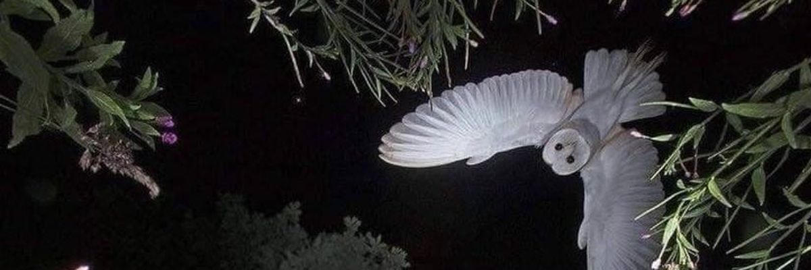

  

# Hey, dear reader (and, I suspect, dear watcher).

I'm **Xav**, a web exploitation and OSINT enjoyer.

I care about OPSEC: what we leave behind, who might be watching, and why. That curiosity also draws me to Tor, onion services, and the darknet. I'm here to understand how these systems work, what they do (and don't) protect, and how people can still be identified. Not to buy anything.

## tech stack

**Systems & tools**

Linux · Docker · Git · Wireshark · Burp Suite · Nmap · VS Code

**Programming & scripting**

Python · JavaScript · C · Java

**Web development & databases**

HTML · CSS · React · MySQL

**Security & CTFs**

Web security · Network security · OSINT · SOCMINT

## interests (i'm rly bad at almost all)

Still learning most of these, sometimes the hard way:

- Web security, exploitation & reconnaissance
- OSINT
- Capture the Flag (CTF)
- Bug bounties
- Homelabbing
- Linux ricing
- Building obnoxious little programs
- Malware research

---

  that's about it. for now.

